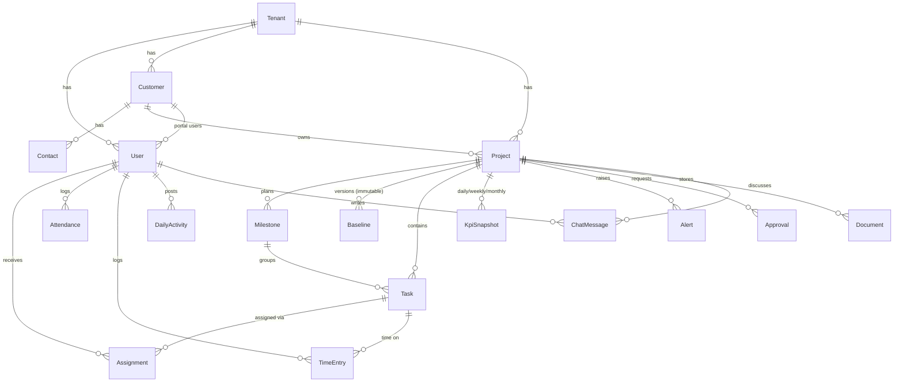

# Entity relationship diagram

Source of truth: `packages/db/prisma/schema.prisma`. Every tenant-owned table carries `tenantId` and is protected by Row-Level Security (`0002_rls_and_indexes`).

Not in the schema yet (Phase 2 or later): Opportunity, ChatChannel (messages are per project for now), leave requests, breaks, task dependencies and subtasks.

## Visibility rules encoded in the schema

- `Milestone.clientVisible`, `Task.clientVisible`, `Document.clientVisible`: default false. Publication is explicit.
- `ChatMessage.internal`: default true. The portal module never returns internal messages.
- `User.hourlyCost`: serializers strip it for every role except CEO.
- `AuditEvent` and `Baseline`: the application database role has no UPDATE or DELETE grant.
